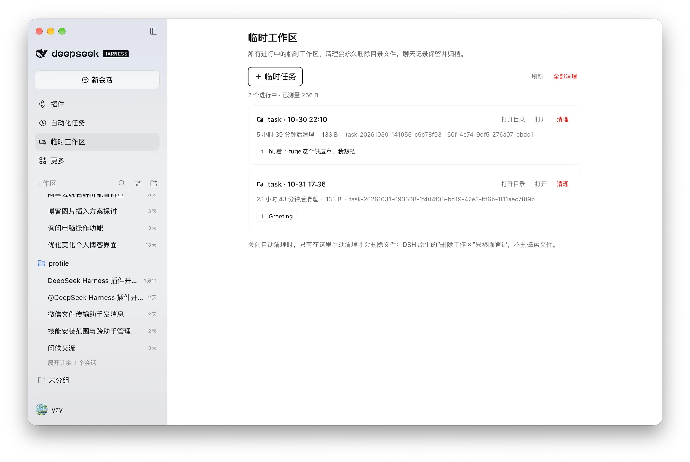

# Temporary Workspaces for DeepSeek Harness

[](https://www.npmjs.com/package/@s0meb0dy3/dsh-scratch-workspace)
[](LICENSE)

English | [中文](README.zh.md)

Throwaway workspaces for [DeepSeek Harness](https://github.com/deepseek-ai/deepseek-harness):
one click to create a folder with its own workspace and session, one panel to manage
every running one, and safe deletion when you are done — or an idle timer that does it
for you.



> [!WARNING]
> Cleanup **permanently deletes the folder and everything inside it** — not the Trash,
> no undo. The conversation is kept and archived.

<!-- Demo video: replace the line below with an embedded video or GIF when it is ready. -->
<!-- 🎬 Demo video — coming soon -->

## Install

1. In DeepSeek Harness, open **Plugins** in the sidebar → **Install**.
2. Paste the package name:

   ```
   @s0meb0dy3/dsh-scratch-workspace
   ```

3. Quit DeepSeek Harness completely and reopen it, then open **Temporary workspaces**
   in the sidebar.

Requires DeepSeek Harness 0.2.1 or newer.

## What you get

- **One entry, two jobs** — the sidebar panel creates (`＋ Temporary task`) and manages
  (list, open, clean up) in the same place.
- **Every task at a glance** — friendly name, live state (running / terminal open),
  idle countdown, folder size, and the sessions inside it.
- **Safe deletion** — ownership and inode checks, a durable retry journal, and refusal
  while the agent or a terminal is still using the folder.
- **Optional idle expiry** — off by default; when on, it applies to new tasks only.

## Docs

| | |
|---|---|
| [Configuration](docs/configuration.md) | Root folder, prefix, confirmation, idle hours |
| [Security model](docs/security.md) | What deletion verifies, and what it does not protect |
| [Platforms](docs/platforms.md) | macOS verified; Windows caveats |
| [Contributing](CONTRIBUTING.md) | Development, tests, release process |

## License

MIT © 2026 s0meb0dy3
