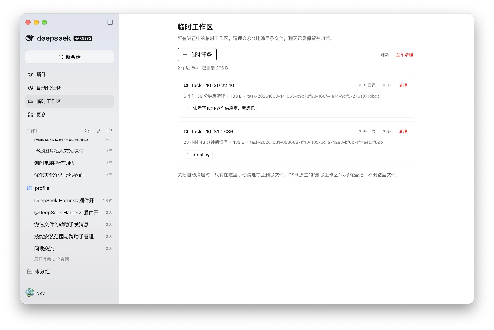

# 临时工作区（DeepSeek Harness 插件）

[](https://www.npmjs.com/package/@s0meb0dy3/dsh-scratch-workspace)
[](LICENSE)

[English](README.md) | 中文

给 [DeepSeek Harness](https://github.com/deepseek-ai/deepseek-harness) 用的「随手开一个临时工作区」：
一键建独立文件夹与会话，在侧边栏面板里统一管理，用完安全删除——或者打开闲置自动清理，让它自己消失。



> [!NOTE]
> 清理会把整个文件夹移入系统**废纸篓 / 回收站**，误删仍可恢复。聊天记录会保留并归档；确认不再需要后再清空废纸篓。

<!-- 演示视频：准备好后把下面这行替换成视频或 GIF 嵌入。 -->
<!-- 🎬 演示视频 —— 即将上线 -->

## 安装

1. 在 DeepSeek Harness 左侧打开 **插件** 页 → **安装**；
2. 粘贴包名：

   ```
   @s0meb0dy3/dsh-scratch-workspace
   ```

3. **完全退出并重开** DeepSeek Harness，然后在左侧打开 **临时工作区**。

需要 DeepSeek Harness 0.2.1 或更新版本。

## 它会给你什么

- **一个入口，两件事** — 侧边栏面板里既创建（`＋ 临时任务`），也管理（列表、打开、清理）。
- **一眼看清每个任务** — 友好名称、实时状态（运行中／终端打开）、闲置倒计时、目录大小，以及其中的会话。
- **删除有保障** — 校验目录所有权与 inode，落盘删除授权可断点重试；agent 或终端仍在用该目录时拒绝清理。
- **可选闲置清理** — 默认关闭；开启后只对新建任务生效。

## 文档

| | |
|---|---|
| [配置项](docs/configuration.md) | 存放位置、目录前缀、删除确认、闲置小时数 |
| [安全模型](docs/security.md) | 删除校验了什么，以及不防什么 |
| [平台支持](docs/platforms.md) | macOS 已验证；Windows 注意事项 |
| [参与开发](CONTRIBUTING.md) | 本地开发、测试、发布流程 |

## 许可证

MIT © 2026 s0meb0dy3
